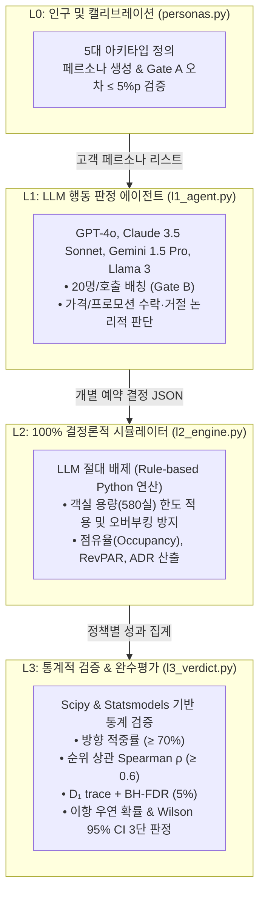

# Walkerhill WISE Simulation (walkerhill_sim-KIMI)

워커힐 호텔 수요 시뮬레이션 및 완수평가 판정 파이프라인 레포지토리입니다.
체크시트(`Walkerhill_완수평가_체크시트.xlsx`)의 수식과 평가 게이트(Gate A~F)를 엄격한 **L0-L1-L2-L3 계층형 아키텍처**로 구현하였습니다.

---

## 🏛️ 계층형 아키텍처 (L0 ~ L3 R&R)



---

## 📁 디렉토리 구조

```text
walkerhill_sim-KIMI/
├── Walkerhill_완수평가_체크시트.xlsx   # 완수평가 기준 및 체크시트 원본
├── wise_sim/
│   ├── personas.py                 # [L0] 아키타입 정의, 페르소나 생성 및 Gate A 캘리브레이션 검증
│   ├── l1_agent.py                 # [L1] LLM 행동 판정 에이전트 (GPT-4o, Claude, MockAgent, 20명 배칭)
│   ├── l2_engine.py                # [L2] 100% 결정론적 룰 기반 시뮬레이터 (재고/점유율/RevPAR 집계)
│   ├── transit_matrix.py           # [옵션] 시설 간 이동시간 행렬 및 이동·대기 불편도
│   ├── l3_verdict.py               # [L3] Scipy/Statsmodels 기반 통계 검증 및 3단 판정 파이프라인
│   ├── l3_abstain.py               # [L3] 표본·방향 안정성·분산·정책 범위 기반 기권 판정
│   ├── gmm_personas.py             # [Mockup] GMM 합성 페르소나 및 로지스틱 가격 민감도 proxy
│   ├── engine.py                   # (Legacy 호환용) L1 및 L2 re-export 모듈
│   └── verdict.py                  # (Legacy 호환용) L3 re-export 모듈
├── tests/
│   └── test_gmm_personas.py        # GMM/가격 민감도 모의 데이터 테스트
├── requirements.txt
├── .gitignore
└── README.md
```

---

## 🔑 계층별 역할 및 기능

### 1. `wise_sim/personas.py` (L0: 인구 풀 & 캘리브레이션)
- 워커힐 5대 투숙객 아키타입 정의:
  - **가족여행** (30%), **커플** (25%), **비즈니스** (20%), **외국인관광** (15%), **프리미엄** (10%)
- `generate_population(n, seed)`: 고정 시드로 재현 가능한 고객 모집단 생성
- `calibrate_check()`: 목표 비율과의 오차 $\le 5\%p$ 검증 (Gate A 통과 기준)

### 2. `wise_sim/l1_agent.py` (L1: LLM Agent - 행동 판정)
- 고객의 페르소나를 이해하고 복잡한 조건(객실가, 프로모션, 투숙일)에서 논리적 수락/거절/기권 판단
- **모델 지원**: GPT-4o, Claude 3.5 Sonnet, Gemini 1.5 Pro, Llama 3 70B 등 OpenAI 호환 엔드포인트 연동
- **Gate B 준수**: 20명/호출 배칭(`BATCH_SIZE = 20`), 시드 고정, 온도 0.7
- **`MockAgent`**: LLM API 키 없이도 전체 파이프라인을 완전 재현 가능하게 검증하는 모의 에이전트

### 3. `wise_sim/l2_engine.py` (L2: 결정론적 엔진 - LLM 미개입)
- **100% 규칙 기반(Rule-based)** 수식만으로 동작 (환각 및 비결정론적 오차 원천 차단)
- 워커힐 총 객실 수(`TOTAL_ROOMS = 580`) 제약 하에 점유율(Occupancy), RevPAR, ADR 계산
- `policy_grid()`: 가격 변동 $(-10\%, 0\%, +10\%)$ $\times$ 프로모션 (`none`, `package`, `breakfast`)의 3×3 정책 격자
- `simulate_weekend()`, `run_policy_grid()`

### 4. `wise_sim/l3_verdict.py` (L3: 통계적 검증 및 3단 판정)
체크시트의 모든 수식을 **`scipy` 및 `statsmodels`**로 검증 (미설치 환경 시 자체 수식 자동 폴백):
- **방향 적중률**: 정책 효과 부호($+ / - / 0$) 일치율 (기준 $\ge 70\%$)
- **순위 상관**: `scipy.stats.spearmanr` (기준 $\rho \ge 0.60$)
- **Trace 분포 검정**: 총변동거리 $D_1$ 계산 후 Benjamini–Hochberg FDR ($q=0.05$) 다중비교 보정
- **백테스트 확률**: `scipy.stats.binomtest` 우연 확률 $P(X \ge k)$ 및 Wilson 95% 신뢰구간
- **3단 판정**: **적합** (전체 지표 보고) / **조건부** (방향만 인용) / **부적합** (인용 불가 및 폐기)

### GMM 페르소나 mockup 실행

`wise_sim/gmm_personas.py`는 실제 PMS 연동 전에 합성 파이프라인을 시험합니다.

1. 모의 가격/프로모션 제안과 예약/비예약 데이터를 생성합니다. 가격 변동은 무작위 배정되어 모의 가격 계수를 추정할 수 있게 합니다.
2. 예약 건수, 숙박 일수, 리드타임, 평균 객실료를 표준화하고 full-covariance GMM(EM)으로 고객군을 찾습니다.
3. GMM 군집별로 예약 여부를 가격·프로모션·주말 조건에 회귀하여 가격 계수를 구합니다.
4. `clip(-price_beta / 5, 0, 1)`을 L1과 연결하기 위한 가격 민감도 proxy로 사용하고, GMM에서 합성 `Persona`를 생성합니다.

```bash
python3 -m pip install -r requirements.txt
python3 -m wise_sim.gmm_personas
python3 -m unittest discover -s tests -v
```

이 mockup은 알고리즘 흐름과 코드 연결을 확인하는 용도이며, 출력된 군집이나 proxy는 호텔 고객 특성의 증거가 아닙니다. 실제 분석에서는 가격 제안/노출과 예약·비예약 결과가 연결된 비식별 데이터가 필요합니다. 과거 가격은 수요에 따라 정해졌을 수 있으므로, 관측 데이터의 로지스틱 계수는 인과적 가격 탄력성을 자동으로 식별하지 않습니다. 정책 효과 주장은 무작위 실험 또는 적절한 인과 추론 설계로 별도 검증해야 합니다.

### Hillink 공개 자료를 WISE 온톨로지에 연결

`wise_sim/hillink_data_adapter.py`는 Hillink 공개 레포의 객실 참고계수, Instagram 행동 표본, 근거 체인 CSV를 검증·요약하고 건물명을 WISE 온톨로지 코드로 매핑합니다. Hillink 레포를 이 레포 옆에 복제한 뒤 실행합니다.

```bash
python3 - <<'PY'
import json
from pathlib import Path
from wise_sim.hillink_data_adapter import extract_hillink_inputs

hillink = Path("../Hillink")
report = extract_hillink_inputs(
    hillink / "hillink/docs/data/ontology_inverse_followup_shh_20261013/객실_온톨로지참고계수_31일.csv",
    hillink / "hillink/docs/instagram_persona_sample.csv",
    hillink / "docs/evidence_chain_20261010.csv",
)
print(json.dumps(report, ensure_ascii=False, indent=2))
PY
```

이 자료는 801실로 집계되는 객실 참고표와 WISE 시뮬레이션의 580실 설정이 달라 자동 보정하지 않습니다. 게시물 표본과 서술형 근거도 예약/비예약 관측치가 아니므로 GMM 페르소나 학습이나 인과효과 추정에 사용하지 않습니다. 보고서에는 매핑된 요약, 불일치, 누락된 분석 입력이 표시됩니다.

### 예약 노출·결과 데이터 계약 (온톨로지 기반)

`wise_sim/schemas/reservation_exposure.schema.json`은 실험/관측 단위 하나와 하나의 제안을 연결하는 JSON Schema입니다. 예약을 한 고객뿐 아니라 적격 대조군, 미노출·비예약·취소 결과도 같은 단위로 보존합니다. 필드는 연결·시점, 실험 배정, 실제 노출/가격, 조건·재고, 관측 기간 내 결과, 데이터 품질, 출처 계층으로 나뉩니다.

스키마는 [wise_hillink_ontology_map.json](./wise_sim/wise_hillink_ontology_map.json)의 `$defs`를 참조해 금액·통화·배정·노출·결과 용어와 건물/SKU/프로모션 매핑을 공유합니다. 각 개념은 `source_system`과 원본 `source_code`, `mapping_status`, `canonical_id`를 함께 기록합니다. 온톨로지에 아직 객실 유형·행사·시즌 코드가 없으므로 이 항목은 `unmapped`로 보존해야 하며, 이름이 비슷하다는 이유로 임의 연결하면 안 됩니다. 정식 코드를 승인해 온톨로지에 등록한 다음 해당 코드의 매핑 스키마를 확장합니다.

식별자는 가명 ID만 허용하고 이메일 등 직접 식별 필드는 스키마에서 거부합니다. 문자열 형식 검사만으로 숫자형 전화번호 같은 직접 식별자나 실제 가명처리 여부를 판별할 수는 없으므로, 승인된 가명처리 절차와 제한된 키 접근을 별도로 확인해야 합니다. `data_origin=synthetic_fixture`는 코드 테스트 자료라는 뜻이며 실제 예약 결과나 인과효과로 보고할 수 없습니다. 스키마 적합성만으로 무작위 배정의 실제 수행, 데이터 품질, 인과 식별 가정이 입증되는 것도 아닙니다.

```bash
python3 -m pip install -r requirements.txt
python3 -m unittest discover -s tests -p 'test_experiment_schema.py' -v
```

합성 레코드 생성 → strict ontology 매핑 → JSON Schema 및 단위 연결 검증 → 예약률/매출 ITT 집계를 한 번에 검증하는 회귀 테스트는 다음과 같이 실행합니다.

```bash
python3 -m unittest discover -s tests -p 'test_synthetic_experiment_pipeline.py' -v
```

테스트 fixture는 200개 가상 단위를 만들며 처리군 10%의 제안 미노출도 포함합니다. ITT는 실제 노출 여부로 대상을 걸러내지 않고 원래 배정군으로 계산합니다. 알려진 fixture 효과(예약률 +9%p, 총매출 +21,600원/배정 단위)를 회수하는지 검사합니다. 가상 응답 유형에 따른 쌍 무작위 배정의 블록 ID를 보존해 paired-block 표준오차와 95% 정규근사 구간을 계산합니다. 이 숫자는 테스트 장치의 정답일 뿐 실제 호텔 효과가 아니며, synthetic 출처로만 표시됩니다. 실제 군집 배정 실험은 별도의 군집 단위 추론이 필요합니다.

### 선택 기능: 시설 간 이동시간

`wise_sim/transit_matrix.py`의 `TransitContext`는 시설 간 N×N 이동시간 행렬을 제공합니다. 기본 행렬은 예시 가정값이며, 실제 행렬을 주입하지 않으면 결과에도 `assumption_based_transit=True`로 표시됩니다. L2에서 `transit_context`를 지정한 경우에만 시설 이동 지표를 결과에 추가합니다.

```python
from wise_sim.transit_matrix import TransitContext

transit = TransitContext()  # 기본 가정 행렬, 실제 도면/실측 기반 아님
result = l2_engine.simulate_weekend(
    agent, pop, policy, weekend_idx=0, seed=42,
    transit_context=transit,
    queue_wait_minutes=5.0,
)
print(result["facility_context"])
```

이동시간과 전달된 `queue_wait_minutes`는 10분 초과 시 비선형 페널티를 포함한 불편도로 합산되고, 프로모션 유인도에서 차감되어 `net_attraction`에 반영됩니다. 현재 대기시간은 입력값이며, 시설 수용량·도착률로 대기행렬을 산출하는 큐 시뮬레이터는 구현하지 않았습니다. 이 지표는 L1 예약 판정을 바꾸지 않고 별도 L2 결과로 추가됩니다. L3 `full_report(..., transit_assumption=True)`는 가정값 고지를 포함하지만, 그 이유만으로 기존 수치 판정을 자동으로 낮추거나 기권시키지는 않습니다.

### L3: Abstain(기권) 판단

`wise_sim/l3_abstain.py`의 `evaluate_l3()`는 다음 조건에서 판정을 보류합니다.

- 관측 단위가 `min_samples` 미만(기본 1,000)
- 부트스트랩 방향 일치율이 0.6 미만
- 변동계수(CV)가 0.5 초과
- 카지노·웨딩 정책처럼 1차 지원 범위 밖인 경우

```python
from wise_sim.l3_abstain import evaluate_l3

result = evaluate_l3(
    samples=policy_effect_samples,
    policy_type="fnb",
    transit_assumption=True,
    seed=42,
)
print(result.to_dict())
```

제안 코드와 달리 표본 부족의 신뢰구간은 JSON 직렬화가 가능한 `[null, null]`로 반환하고, 부트스트랩 시드를 고정해 재현 가능하게 했습니다. 이동시간 가정값은 별도 주의 문구로 표시하지만, 그 이유만으로 자동 기권시키지는 않습니다. 표본 수는 독립 정보량과 같지 않을 수 있으므로, 같은 주말·고객군에서 반복 생성한 결과를 독립 표본으로 세면 안 됩니다. 부트스트랩은 방향 안정성 요약이며 정책의 인과 효과나 sim-to-real 타당성을 증명하지 않습니다.

---

## 🚀 빠른 시작 (Quick Start)

```python
import sys
sys.path.append("wise_sim")

import personas
import l1_agent
import l2_engine
import l3_verdict

# 1. [L0] 고객 페르소나 생성 및 Gate A 캘리브레이션 검증
pop = personas.generate_population(n=400, seed=42)
assert personas.calibrate_check(pop)["pass"] is True

# 2. [L1 & L2] 에이전트 및 결정론적 시뮬레이션 실행
agent = l1_agent.MockAgent()  # 또는 l1_agent.LLMAgent(model="gpt-4o")
policy = l1_agent.Policy(price_delta=0.0, promo="breakfast")
result = l2_engine.simulate_weekend(agent, pop, policy, weekend_idx=0, seed=42)

print(f"점유율: {result['occupancy']:.1%}, RevPAR: {result['revpar']:,.0f}원")

# 3. [L3] 통계적 판정 리포트 생성
rho = l3_verdict.spearman_rho([0.1, 0.2, 0.3], [0.12, 0.18, 0.31])
lo, hi = l3_verdict.wilson_ci(k=8, n=10)
label, cite = l3_verdict.verdict(direction=0.80, n_exceed=0)
print(f"L3 완수평가 판정: {label} ({cite})")
```
