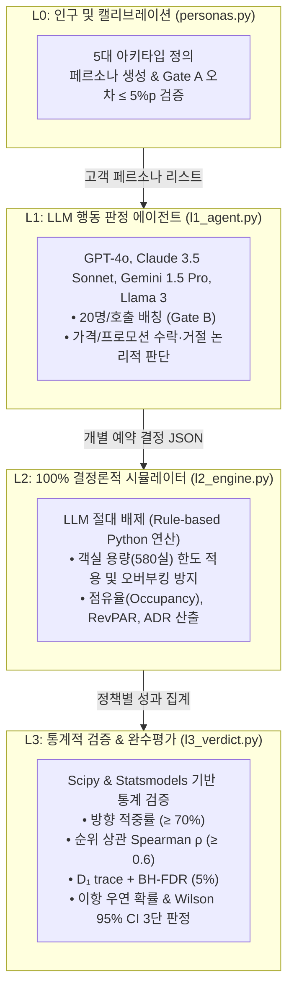

# Walkerhill WISE Simulation (walkerhill_sim-KIMI)

워커힐 호텔 수요 시뮬레이션 및 완수평가 판정 파이프라인 레포지토리입니다.
체크시트(`Walkerhill_완수평가_체크시트.xlsx`)의 수식과 평가 게이트(Gate A~F)를 엄격한 **L0-L1-L2-L3 계층형 아키텍처**로 구현하였습니다.

---

## 🏛️ 계층형 아키텍처 (L0 ~ L3 R&R)



---

## 📁 디렉토리 구조

```text
walkerhill_sim-KIMI/
├── Walkerhill_완수평가_체크시트.xlsx   # 완수평가 기준 및 체크시트 원본
├── wise_sim/
│   ├── personas.py                 # [L0] 아키타입 정의, 페르소나 생성 및 Gate A 캘리브레이션 검증
│   ├── l1_agent.py                 # [L1] LLM 행동 판정 에이전트 (GPT-4o, Claude, MockAgent, 20명 배칭)
│   ├── l2_engine.py                # [L2] 100% 결정론적 룰 기반 시뮬레이터 (재고/점유율/RevPAR 집계)
│   ├── l3_verdict.py               # [L3] Scipy/Statsmodels 기반 통계 검증 및 3단 판정 파이프라인
│   ├── engine.py                   # (Legacy 호환용) L1 및 L2 re-export 모듈
│   └── verdict.py                  # (Legacy 호환용) L3 re-export 모듈
├── .gitignore
└── README.md
```

---

## 🔑 계층별 역할 및 기능

### 1. `wise_sim/personas.py` (L0: 인구 풀 & 캘리브레이션)
- 워커힐 5대 투숙객 아키타입 정의:
  - **가족여행** (30%), **커플** (25%), **비즈니스** (20%), **외국인관광** (15%), **프리미엄** (10%)
- `generate_population(n, seed)`: 고정 시드로 재현 가능한 고객 모집단 생성
- `calibrate_check()`: 목표 비율과의 오차 $\le 5\%p$ 검증 (Gate A 통과 기준)

### 2. `wise_sim/l1_agent.py` (L1: LLM Agent - 행동 판정)
- 고객의 페르소나를 이해하고 복잡한 조건(객실가, 프로모션, 투숙일)에서 논리적 수락/거절/기권 판단
- **모델 지원**: GPT-4o, Claude 3.5 Sonnet, Gemini 1.5 Pro, Llama 3 70B 등 OpenAI 호환 엔드포인트 연동
- **Gate B 준수**: 20명/호출 배칭(`BATCH_SIZE = 20`), 시드 고정, 온도 0.7
- **`MockAgent`**: LLM API 키 없이도 전체 파이프라인을 완전 재현 가능하게 검증하는 모의 에이전트

### 3. `wise_sim/l2_engine.py` (L2: 결정론적 엔진 - LLM 미개입)
- **100% 규칙 기반(Rule-based)** 수식만으로 동작 (환각 및 비결정론적 오차 원천 차단)
- 워커힐 총 객실 수(`TOTAL_ROOMS = 580`) 제약 하에 점유율(Occupancy), RevPAR, ADR 계산
- `policy_grid()`: 가격 변동 $(-10\%, 0\%, +10\%)$ $\times$ 프로모션 (`none`, `package`, `breakfast`)의 3×3 정책 격자
- `simulate_weekend()`, `run_policy_grid()`

### 4. `wise_sim/l3_verdict.py` (L3: 통계적 검증 및 3단 판정)
체크시트의 모든 수식을 **`scipy` 및 `statsmodels`**로 검증 (미설치 환경 시 자체 수식 자동 폴백):
- **방향 적중률**: 정책 효과 부호($+ / - / 0$) 일치율 (기준 $\ge 70\%$)
- **순위 상관**: `scipy.stats.spearmanr` (기준 $\rho \ge 0.60$)
- **Trace 분포 검정**: 총변동거리 $D_1$ 계산 후 Benjamini–Hochberg FDR ($q=0.05$) 다중비교 보정
- **백테스트 확률**: `scipy.stats.binomtest` 우연 확률 $P(X \ge k)$ 및 Wilson 95% 신뢰구간
- **3단 판정**: **적합** (전체 지표 보고) / **조건부** (방향만 인용) / **부적합** (인용 불가 및 폐기)

---

## 🚀 빠른 시작 (Quick Start)

```python
import sys
sys.path.append("wise_sim")

import personas
import l1_agent
import l2_engine
import l3_verdict

# 1. [L0] 고객 페르소나 생성 및 Gate A 캘리브레이션 검증
pop = personas.generate_population(n=400, seed=42)
assert personas.calibrate_check(pop)["pass"] is True

# 2. [L1 & L2] 에이전트 및 결정론적 시뮬레이션 실행
agent = l1_agent.MockAgent()  # 또는 l1_agent.LLMAgent(model="gpt-4o")
policy = l1_agent.Policy(price_delta=0.0, promo="breakfast")
result = l2_engine.simulate_weekend(agent, pop, policy, weekend_idx=0, seed=42)

print(f"점유율: {result['occupancy']:.1%}, RevPAR: {result['revpar']:,.0f}원")

# 3. [L3] 통계적 판정 리포트 생성
rho = l3_verdict.spearman_rho([0.1, 0.2, 0.3], [0.12, 0.18, 0.31])
lo, hi = l3_verdict.wilson_ci(k=8, n=10)
label, cite = l3_verdict.verdict(direction=0.80, n_exceed=0)
print(f"L3 완수평가 판정: {label} ({cite})")
```
