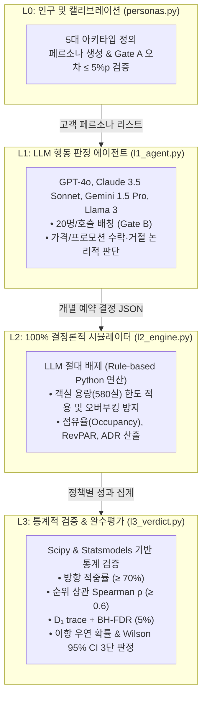

# Walkerhill WISE Simulation (walkerhill_sim-KIMI)

워커힐 호텔 수요 시뮬레이션 및 완수평가 판정 파이프라인 레포지토리입니다.
체크시트(`Walkerhill_완수평가_체크시트.xlsx`)의 수식과 평가 게이트(Gate A~F)를 엄격한 **L0-L1-L2-L3 계층형 아키텍처**로 구현하였습니다.

---

## 🏛️ 계층형 아키텍처 (L0 ~ L3 R&R)



---

## 📁 디렉토리 구조

```text
walkerhill_sim-KIMI/
├── Walkerhill_완수평가_체크시트.xlsx   # 완수평가 기준 및 체크시트 원본
├── wise_sim/
│   ├── personas.py                 # [L0] 아키타입 정의, 페르소나 생성 및 Gate A 캘리브레이션 검증
│   ├── l1_agent.py                 # [L1] LLM 행동 판정 에이전트 (GPT-4o, Claude, MockAgent, 20명 배칭)
│   ├── l2_engine.py                # [L2] 100% 결정론적 룰 기반 시뮬레이터 (재고/점유율/RevPAR 집계)
│   ├── demand_backtest.py          # 일별 실적 예측, 시간순 홀드아웃 및 24배 가상 시계 재생
│   ├── transit_matrix.py           # [옵션] 시설 간 이동시간 행렬 및 이동·대기 불편도
│   ├── l3_verdict.py               # [L3] Scipy/Statsmodels 기반 통계 검증 및 3단 판정 파이프라인
│   ├── l3_abstain.py               # [L3] 표본·방향 안정성·분산·정책 범위 기반 기권 판정
│   ├── gmm_personas.py             # [Mockup] GMM 합성 페르소나 및 로지스틱 가격 민감도 proxy
│   ├── engine.py                   # (Legacy 호환용) L1 및 L2 re-export 모듈
│   └── verdict.py                  # (Legacy 호환용) L3 re-export 모듈
├── tests/
│   └── test_gmm_personas.py        # GMM/가격 민감도 모의 데이터 테스트
├── requirements.txt
├── .gitignore
└── README.md
```

---

## 🔑 계층별 역할 및 기능

### 1. `wise_sim/personas.py` (L0: 인구 풀 & 캘리브레이션)
- 워커힐 5대 투숙객 아키타입 정의:
  - **가족여행** (30%), **커플** (25%), **비즈니스** (20%), **외국인관광** (15%), **프리미엄** (10%)
- `generate_population(n, seed)`: 고정 시드로 재현 가능한 고객 모집단 생성
- `calibrate_check()`: 목표 비율과의 오차 $\le 5\%p$ 검증 (Gate A 통과 기준)

### 2. `wise_sim/l1_agent.py` (L1: LLM Agent - 행동 판정)
- 고객의 페르소나를 이해하고 복잡한 조건(객실가, 프로모션, 투숙일)에서 논리적 수락/거절/기권 판단
- **모델 지원**: GPT-4o, Claude 3.5 Sonnet, Gemini 1.5 Pro, Llama 3 70B 등 OpenAI 호환 엔드포인트 연동
- **Ollama Cloud**: 내부 Ollama API를 통해 `glm-5.3-flash:cloud` 같은 클라우드 모델 호출 가능
- **Gate B 준수**: 20명/호출 배칭(`BATCH_SIZE = 20`), 시드 고정, 온도 0.7
- **`MockAgent`**: LLM API 키 없이도 전체 파이프라인을 완전 재현 가능하게 검증하는 모의 에이전트

#### 내부 WISE에서 Ollama Cloud GLM으로 페르소나 시뮬레이션

Ollama Cloud 카탈로그의 GLM-5.3-Flash를 사용하려면 Ollama 앱/CLI에서 계정 로그인을 완료하고, WISE가 접근하는 Ollama 서버에서 모델을 확인합니다. Ollama가 같은 컴퓨터에서 실행되면 기본 주소 `http://127.0.0.1:11434/v1`를 사용합니다. 다른 내부 서버라면 `WISE_OLLAMA_BASE_URL`을 해당 서버의 사설 네트워크 주소로 바꿉니다.

```bash
# Ollama 앱에서 로그인한 뒤 모델 접근을 확인
ollama run glm-5.3-flash:cloud

export WISE_OLLAMA_MODEL='glm-5.3-flash:cloud'
export WISE_OLLAMA_BASE_URL='http://127.0.0.1:11434/v1'

python3 - <<'PY'
from wise_sim.personas import generate_population, calibrate_check
from wise_sim.l1_agent import get_ollama_cloud_agent, Policy
from wise_sim.l2_engine import simulate_weekend

personas = generate_population(n=20, seed=42)
assert calibrate_check(personas)["pass"]
agent = get_ollama_cloud_agent()
result = simulate_weekend(
    agent,
    personas,
    Policy(price_delta=0.0, promo="package"),
    weekend_idx=0,
    seed=42,
)
print({
    "agent": agent.name,
    "model": agent.model,
    "synthetic_personas": result["n_personas"],
    "booked_count": result["booked_count"],
    "booking_rate": result["booking_rate"],
    "occupancy": result["occupancy"],
    "adr": result["adr"],
    "revpar": result["revpar"],
})
PY
```

Ollama Cloud 추론은 로컬 실행이 아닙니다. WISE는 내부 Ollama HTTP API를 호출하지만, Ollama는 프롬프트를 외부 Ollama Cloud로 전달하며 GLM-5.3-Flash 모델 카탈로그는 호스팅 위치를 미국·유럽으로 안내합니다. 이 예시는 생성된 합성 페르소나만 보내고, 실제 고객·예약 데이터는 넣지 않습니다. 외부 데이터 처리와 계정의 보존/정책 조건을 운영 전에 검토해야 합니다. Ollama API는 기본적으로 인증 경계로 간주하지 말고, 내부망에서도 방화벽/VPN으로 제한하며 외부에 직접 노출하지 마세요.

현재 L1 프롬프트의 `package`/`breakfast`는 일반적인 시뮬레이션 레이블입니다. 이 코드만으로 크리스마스 패키지의 실제 구성요소·가격·메뉴를 각각 모델링하지 않으며, 산출된 예약 의사도 실제 고객 선호나 수요 예측이 아닌 모델 기반 합성 시나리오입니다. 크리스마스 상품 가설을 구체적으로 비교하려면 각 SKU의 확인된 가격·혜택을 입력으로 받는 상품별 실험 어댑터가 추가로 필요합니다. 이 실행에는 배치당 한 번의 외부 모델 호출이 발생하므로 먼저 20명 단일 시나리오로 점검하고, 전체 정책 격자 실행 전 비용·지연을 확인하세요.

### 3. `wise_sim/l2_engine.py` (L2: 결정론적 엔진 - LLM 미개입)
- **100% 규칙 기반(Rule-based)** 수식만으로 동작 (환각 및 비결정론적 오차 원천 차단)
- 워커힐 총 객실 수(`TOTAL_ROOMS = 580`) 제약 하에 점유율(Occupancy), RevPAR, ADR 계산
- `policy_grid()`: 가격 변동 $(-10\%, 0\%, +10\%)$ $\times$ 프로모션 (`none`, `package`, `breakfast`)의 3×3 정책 격자
- `simulate_weekend()`, `run_policy_grid()`

### 4. `wise_sim/l3_verdict.py` (L3: 통계적 검증 및 3단 판정)
체크시트의 모든 수식을 **`scipy` 및 `statsmodels`**로 검증 (미설치 환경 시 자체 수식 자동 폴백):
- **방향 적중률**: 정책 효과 부호($+ / - / 0$) 일치율 (기준 $\ge 70\%$)
- **순위 상관**: `scipy.stats.spearmanr` (기준 $\rho \ge 0.60$)
- **Trace 분포 검정**: 총변동거리 $D_1$ 계산 후 Benjamini–Hochberg FDR ($q=0.05$) 다중비교 보정
- **백테스트 확률**: `scipy.stats.binomtest` 우연 확률 $P(X \ge k)$ 및 Wilson 95% 신뢰구간
- **3단 판정**: **적합** (전체 지표 보고) / **조건부** (방향만 인용) / **부적합** (인용 불가 및 폐기)

### GMM 페르소나 mockup 실행

`wise_sim/gmm_personas.py`는 실제 PMS 연동 전에 합성 파이프라인을 시험합니다.

1. 모의 가격/프로모션 제안과 예약/비예약 데이터를 생성합니다. 가격 변동은 무작위 배정되어 모의 가격 계수를 추정할 수 있게 합니다.
2. 예약 건수, 숙박 일수, 리드타임, 평균 객실료를 표준화하고 full-covariance GMM(EM)으로 고객군을 찾습니다.
3. GMM 군집별로 예약 여부를 가격·프로모션·주말 조건에 회귀하여 가격 계수를 구합니다.
4. `clip(-price_beta / 5, 0, 1)`을 L1과 연결하기 위한 가격 민감도 proxy로 사용하고, GMM에서 합성 `Persona`를 생성합니다.

```bash
python3 -m pip install -r requirements.txt
python3 -m wise_sim.gmm_personas
python3 -m unittest discover -s tests -v
```

이 mockup은 알고리즘 흐름과 코드 연결을 확인하는 용도이며, 출력된 군집이나 proxy는 호텔 고객 특성의 증거가 아닙니다. 실제 분석에서는 가격 제안/노출과 예약·비예약 결과가 연결된 비식별 데이터가 필요합니다. 과거 가격은 수요에 따라 정해졌을 수 있으므로, 관측 데이터의 로지스틱 계수는 인과적 가격 탄력성을 자동으로 식별하지 않습니다. 정책 효과 주장은 무작위 실험 또는 적절한 인과 추론 설계로 별도 검증해야 합니다.

### Hillink 공개 자료를 WISE 온톨로지에 연결

`wise_sim/hillink_data_adapter.py`는 Hillink 공개 레포의 객실 참고계수, Instagram 행동 표본, 근거 체인 CSV를 검증·요약하고 건물명을 WISE 온톨로지 코드로 매핑합니다. Hillink 레포를 이 레포 옆에 복제한 뒤 실행합니다.

```bash
python3 - <<'PY'
import json
from pathlib import Path
from wise_sim.hillink_data_adapter import extract_hillink_inputs

hillink = Path("../Hillink")
report = extract_hillink_inputs(
    hillink / "hillink/docs/data/ontology_inverse_followup_shh_20261013/객실_온톨로지참고계수_31일.csv",
    hillink / "hillink/docs/instagram_persona_sample.csv",
    hillink / "docs/evidence_chain_20261010.csv",
)
print(json.dumps(report, ensure_ascii=False, indent=2))
PY
```

이 자료는 801실로 집계되는 객실 참고표와 WISE 시뮬레이션의 580실 설정이 달라 자동 보정하지 않습니다. 게시물 표본과 서술형 근거도 예약/비예약 관측치가 아니므로 GMM 페르소나 학습이나 인과효과 추정에 사용하지 않습니다. 보고서에는 매핑된 요약, 불일치, 누락된 분석 입력이 표시됩니다.

#### Hillink 전체 저장소 JSON 계약 및 프롬프트 캐시

Hillink 저장소 전체를 하나의 프롬프트나 하나의 도메인 레코드로 오해하지 않도록 `wise_sim/hillink_corpus.py`가 저장소 파일 인벤토리와 추출 가능한 구조화 자료의 필드 계약을 생성합니다. 각 파일에는 경로, 크기, SHA-256, 형식, 근거 도메인, 추출 상태가 포함됩니다. CSV/TSV는 행 수·열 이름·추정 타입, JSON/JSONL은 구조/키 정보를 기록하고 문서는 제목·크기 메타데이터만 남깁니다. 코드·이미지·PDF·압축물은 출처 인벤토리에 포함하되 레코드로 해석하지 않습니다. 추출 오류는 해당 파일에 표시되며 조용히 건너뛰지 않습니다.

Hillink 로컬 복제본을 준비한 뒤 전체 계약을 생성하고 JSON Schema로 확인합니다.

```bash
python3 -m wise_sim.hillink_corpus ../Hillink --output wise_sim/schemas/hillink_repository_contract.snapshot.json
```

계약 스키마는 `wise_sim/schemas/hillink_repository_contract.schema.json`이고 생성한 snapshot은 `wise_sim/schemas/hillink_repository_contract.snapshot.json`입니다. snapshot은 Hillink 커밋 `165f9d5297ba885e108ab29b9b3ea08bbe63bc87`의 2,279개 파일(258,099,593 bytes)을 전부 인벤토리화했습니다. 이 중 313개 CSV/TSV/JSON/JSONL은 구조 계약 추출, 918개 문서·코드 파일은 메타데이터 추출, 1,048개 바이너리/미지원 형식은 불투명 원본으로 기록했으며 파싱 오류는 0건입니다. 각 항목의 SHA-256으로 로컬 checkout 내용을 확인하며, 중복 파일은 서로 다른 경로의 출처 항목으로 유지합니다. 재생성 시 전체 checkout에서 해당 커밋을 확인하세요.

고정된 계약/해석 규칙은 system 메시지의 앞부분에 두고, 배치별 페르소나는 user 메시지 뒤에 둡니다. 계약을 반복 전달할 때 다음처럼 system prefix를 구성할 수 있습니다.

```python
from wise_sim.hillink_corpus import build_hillink_contract, build_stable_prompt_context
from wise_sim.l1_agent import get_ollama_cloud_agent

contract = build_hillink_contract("../Hillink")
agent = get_ollama_cloud_agent(
    system_context=build_stable_prompt_context(contract),
)
# decide_batch(...) 실행 후 agent.last_prompt_usage에서 공급자가 반환한
# prompt_tokens / cached_prompt_tokens를 확인할 수 있습니다.
```

이 방식은 동일한 system prefix를 유지하고 로컬에서 문자열 조립을 재사용하지만, 모델의 KV/prompt 캐시 적중을 보장하지는 않습니다. Ollama API 응답이 `prompt_eval_cached_count` 또는 OpenAI 호환 `usage.prompt_tokens_details.cached_tokens`를 반환할 때만 `cached_prompt_tokens`에 기록합니다. 캐시 제어 옵션은 요청에 임의로 추가하지 않습니다. system prefix에는 커밋·파일 수·형식/도메인 집계 등 작은 계약 요약만 넣습니다. 원문과 고객 행은 캐시 prefix에 넣지 말고 로컬에서 필요한 근거만 골라 출처 경로와 함께 별도 전달하세요. GLM Cloud 경로는 프롬프트를 외부 Ollama Cloud로 보내므로 실제 고객·예약 데이터를 포함해서는 안 됩니다.

### 예약 노출·결과 데이터 계약 (온톨로지 기반)

`wise_sim/schemas/reservation_exposure.schema.json`은 실험/관측 단위 하나와 하나의 제안을 연결하는 JSON Schema입니다. 예약을 한 고객뿐 아니라 적격 대조군, 미노출·비예약·취소 결과도 같은 단위로 보존합니다. 필드는 연결·시점, 실험 배정, 실제 노출/가격, 조건·재고, 관측 기간 내 결과, 데이터 품질, 출처 계층으로 나뉩니다.

스키마는 [wise_hillink_ontology_map.json](./wise_sim/wise_hillink_ontology_map.json)의 `$defs`를 참조해 금액·통화·배정·노출·결과 용어와 건물/SKU/프로모션 매핑을 공유합니다. 각 개념은 `source_system`과 원본 `source_code`, `mapping_status`, `canonical_id`를 함께 기록합니다. 온톨로지에 아직 객실 유형·행사·시즌 코드가 없으므로 이 항목은 `unmapped`로 보존해야 하며, 이름이 비슷하다는 이유로 임의 연결하면 안 됩니다. 정식 코드를 승인해 온톨로지에 등록한 다음 해당 코드의 매핑 스키마를 확장합니다.

식별자는 가명 ID만 허용하고 이메일 등 직접 식별 필드는 스키마에서 거부합니다. 문자열 형식 검사만으로 숫자형 전화번호 같은 직접 식별자나 실제 가명처리 여부를 판별할 수는 없으므로, 승인된 가명처리 절차와 제한된 키 접근을 별도로 확인해야 합니다. `data_origin=synthetic_fixture`는 코드 테스트 자료라는 뜻이며 실제 예약 결과나 인과효과로 보고할 수 없습니다. 스키마 적합성만으로 무작위 배정의 실제 수행, 데이터 품질, 인과 식별 가정이 입증되는 것도 아닙니다.

```bash
python3 -m pip install -r requirements.txt
python3 -m unittest discover -s tests -p 'test_experiment_schema.py' -v
```

합성 레코드 생성 → strict ontology 매핑 → JSON Schema 및 단위 연결 검증 → 예약률/매출 ITT 집계를 한 번에 검증하는 회귀 테스트는 다음과 같이 실행합니다.

```bash
python3 -m unittest discover -s tests -p 'test_synthetic_experiment_pipeline.py' -v
```

테스트 fixture는 200개 가상 단위를 만들며 처리군 10%의 제안 미노출도 포함합니다. ITT는 실제 노출 여부로 대상을 걸러내지 않고 원래 배정군으로 계산합니다. 알려진 fixture 효과(예약률 +9%p, 총매출 +21,600원/배정 단위)를 회수하는지 검사합니다. 가상 응답 유형에 따른 쌍 무작위 배정의 블록 ID를 보존해 paired-block 표준오차와 95% 정규근사 구간을 계산합니다. 이 숫자는 테스트 장치의 정답일 뿐 실제 호텔 효과가 아니며, synthetic 출처로만 표시됩니다. 실제 군집 배정 실험은 별도의 군집 단위 추론이 필요합니다.

### 배정 중심 실제 파일럿 결과 구성

`wise_sim.experiment_pipeline.build_experiment_unit_facts(...)`는 배정표를 기준으로 노출·결제 예약·취소·환불·원가·운영 이벤트·설문 원장을 집계해 **배정 단위당 한 행**인 `facts`와 데이터 품질 `quality`를 반환합니다. 예약자·투숙자·노출자에서 출발해 분석 모집단을 만들지 않습니다. 배정 ID는 불변의 가명 ID여야 하며 모든 후속 이벤트는 배정 또는 예약 ID로 연결해야 합니다.

입력 원장 계약은 다음과 같습니다. 모든 이벤트에는 재수집 중복을 탐지할 고유 `event_id`(설문은 `survey_id`)가 필요하며, 금액은 `amount`와 `currency`를 함께 제공합니다.

| 입력 | 필수 필드 |
|---|---|
| assignments | `experiment_id`, `design`, `data_origin`, `assignment_id`, `unit_id`, `segment`, `assigned_variant`, `assignment_probability`, `assigned_at`, 사전 확정 `outcome_matures_at`, `protocol_id`, `eligibility_version`, `assignment_logic_version` |
| exposures | `event_id`, `assignment_id`, `exposed_at`, 실제 `rendered_variant`, `page`, `channel`, `price`, `inventory_snapshot` |
| bookings | 고유 `booking_id`, `assignment_id` (미귀속이면 null), 서버 예약 생성 `booked_at` |
| payments | 고유 `payment_id`, `booking_id`, `payment_status`, 서버 결제 확정 `paid_at`, `amount`, `currency` |
| cancellations | append-only 상태 이력: `event_id`, `booking_id`, `cancelled_at`, `status` (`cancelled`/`reinstated`), `fee_amount`, `currency` |
| refunds | append-only 상태 이력: `event_id`, `refund_id`, `booking_id`, `payment_id`, `event_at`, `status` (`pending`/`completed`/`failed`/`reversed`), `amount`, `currency`; cutoff 시점의 최신 상태가 `completed`인 환불만 합산 |
| costs | `event_id`, `booking_id`, `incurred_at`, `amount`, `currency` |
| stays | `event_id`, `booking_id`, `checked_in_at`, `checked_out_at` |
| operations | `event_id`, `assignment_id`, `occurred_at`, `event_type` (`complaint`/`safety_incident`); 안전 사고는 `severity` 포함 |
| surveys | `survey_id`, `assignment_id`, `invited_at`, `responded_at`, `satisfaction_score`, `recommendation_score` |

`analysis_cutoff_at`과 `source_complete_through`를 명시해야 하며, 두 번째 값은 각 원장이 그 시점까지 완전하다는 호출자의 확인입니다. `outcome_matures_at`은 실험 전에 숙박 종료·환불 마감·운영 기록·설문 회수 기간을 고려해 단위별로 고정합니다. 해당 시점 전에 분석하면 재무·운영·설문 ITT는 거부됩니다. 결제 귀속은 **배정 시각 기준**으로 고정된 `attribution_window_days`만 사용하며, 실제 노출 시각이나 구매 상품에 따라 배정을 바꾸지 않습니다.

분석에는 `estimate_fact_itt(facts, metric, segment=...)`를 사용합니다. 지원 지표는 `paid_booking`, `net_booking`, `fully_cancelled`, `booking_count`, `gross_payment`, `refund_amount`, `net_revenue`, `variable_cost`, `contribution_margin`, `complaint_count`, `safety_incident_count`, `survey_responded`입니다. `segment="family"`와 `segment="adult"`를 따로 분석합니다. 노출하지 않은 사람과 구매하지 않은 사람은 배정군에 남아 0 결과로 포함됩니다. 금액은 성공 결제액−cutoff 시점 완료 환불액, 기여이익은 순매출−연결된 변동원가로 구성하며 환불이 결제액을 넘으면 실패합니다. 취소수수료는 원장 대사용 필드로 따로 보존하지만 결제액에 이미 포함된 금액으로 간주해 매출에 다시 더하지 않습니다. 불만·사고는 배정 단위당 ITT 결과이며, 투숙 100건당 비율은 별도 운영 모니터링으로 계산해야 합니다.

`quality`는 세그먼트별 배정군 수와 근사 SRM 진단, 노출-배정 variant 불일치, 미귀속 예약·투숙 수, 귀속 기간 밖 예약 수, 성숙 결과 수, 통화별 배정 fact 합계와 원장 합계 간 차이를 포함합니다. `summarize_operations_per_stay(...)`는 투숙 100건당 민원·사고율을 별도 운영 모니터링으로 제공하며 사후 투숙자 조건부 수치이므로 ITT로 해석하지 않습니다. 설문 점수 평균은 `summarize_survey_responders(...)`로 응답자 한정 기술통계만 제공하며 ITT 효과로 표시하지 않습니다. 설문 응답률은 별도 ITT 지표입니다.

```bash
python3 -m unittest discover -s tests -p 'test_experiment_unit_facts.py' -v
```

이 코드는 원장 **집계·검증·분석 로직**이며 PMS/결제/웹/설문 시스템의 실시간 연결, 개인정보 승인, 원천 데이터 수집 자체는 구현하지 않습니다. 실제 효과 분석에는 승인된 가명 ID와 배정 로그, 모든 결과 원장, 각 원장의 완전성 확인 및 고정된 분석 버전이 필요합니다. 누락된 assignment link는 `quality`에 미귀속 건수로 노출되며 이를 임의로 배정군에 넣지 않습니다.

#### 로컬 웹 대시보드

Hillink와 비슷하게 Python 표준 라이브러리 HTTP 서버와 바닐라 JS로 실행하는 stateful 대시보드입니다. 별도 Node 패키지나 외부 차트 서비스 없이 localhost에서 열립니다.

```bash
python3 -m wise_sim.web_app
# http://127.0.0.1:8766
```

대시보드는 실험·프로토콜, 배정과 실제 노출/SRM, 예약·취소 반영 예약률·결제/환불/순매출/기여이익 ITT, 불만·안전사고 ITT 및 투숙자 기준 운영 모니터링, 설문 응답률과 응답자 한정 점수, 데이터 품질·원장 대사, 배정 단위 fact를 탭으로 렌더링합니다. `JSON 템플릿 받기`로 원장 묶음 구조를 받은 뒤 실제 승인 데이터로 채우세요. 지표를 계산할 수 없거나 결과가 미성숙하면 값 대신 불가 사유를 표시합니다.

실험 입력의 최상위 구조는 `experiment` 설정 객체와 앞 표에 적힌 10개 원장 배열입니다. 대시보드는 한 브라우저 세션에 분석 fact만 보관하며 원본 요청 JSON은 저장하지 않습니다. 세션은 서버 프로세스 메모리에 최대 4시간 유지되며 서버 종료 시 삭제됩니다. 서버는 `127.0.0.1`에만 바인딩하고 교차 출처 요청을 거부합니다. 원장 파일은 20MB까지, 배정은 50,000건까지 허용합니다. 브라우저 화면과 API 응답에는 가명 ID가 포함될 수 있으므로 직접 식별정보는 올리지 말고 승인된 로컬 환경에서만 실행하세요. 이 UI는 PMS/결제 시스템과 실시간 연동하지 않습니다.

```bash
python3 -m unittest discover -s tests -p 'test_web_app.py' -v
```

### 크리스마스 패키지 파일럿 준비

`wise_sim/package_pilot.py`는 제안된 구성요소 실험을 별도 두 실험으로 배정합니다.

- 가족: Memorable Familycation 기본 구성 대 동일 구성 + 키즈 액티비티 키트
- 성인: Douglas Rest Together 기본 구성 대 동일 구성 + 라운지 칵테일/와인 혜택

기존 객실+조식 패키지는 가격·객실·구성이 다를 수 있어 이 구성요소 실험의 대조군으로 섞지 않습니다. 가족과 성인의 전환율을 서로 직접 비교하지 않습니다. 이 도구는 1:1 고객 단위 배정을 세그먼트 안에서 수행하고, 선택적으로 `stay_date`, `channel`로 층화합니다. 같은 고객이 반복 노출될 때는 고객 ID로 최초 배정을 고정해 유지해야 합니다.

먼저 합성 ID 100명씩(세그먼트별 각 군 50명)의 배정만 확인합니다. 결과에는 예약 결과나 효과 추정이 없습니다.

```bash
python3 -m wise_sim.package_pilot dry-run --customers-per-segment 100 --seed 42
```

실제 배정표가 필요할 때는 승인된 eligibility 목록을 CSV로 준비합니다. `customer_id`에는 직접 식별자가 아닌 승인된 가명 ID만 넣고, `segment` 값은 `family` 또는 `adult`여야 합니다.

```csv
customer_id,segment,stay_date,channel
pseudo-001,family,2026-12-20,web
pseudo-002,adult,2026-12-21,app
```

```bash
python3 -m wise_sim.package_pilot assign eligible_pseudonymous.csv assignments.csv \
  --stratify-by stay_date channel --seed 42
```

Hillink의 `hillink/timeline/persona_grid.csv`에서 **가정 기반 페르소나 셀**을 템플릿으로 삼은 더미 적격 CSV는 다음처럼 생성합니다.

```bash
python3 -m wise_sim.package_pilot make-hillink-dummy ../Hillink \
  examples/christmas_2026_hillink_synthetic_eligible.csv \
  --customers-per-segment 96 --seed 42 --start-date 2026-12-18
```

가족 템플릿은 `가족·친족` 목적, 아동 동반, 1박 이상으로 제한하고, 성인 템플릿은 아동 비동반의 `커플·기념일`, `혼자 휴식`, `휴식·산책 동행`, `미식 방문` 목적 중 1박 이상을 사용합니다. 2026-12-18~25 숙박일과 `web`/`app` 채널은 드라이런의 균형 배정 확인을 위해 생성한 값이며 Hillink 관측값이 아닙니다. source row 경로·행 번호·리비전은 추적용입니다. 인스타그램 표본의 account hash, 게시물 문구, 개인 레코드는 복사하지 않습니다.

Hillink persona grid 자체도 대표자 인구통계와 여러 가정을 조합한 합성/추정 분포이며, 실제 적격 예약 고객 명단이나 전환 표본이 아닙니다. 생성된 행은 전부 `synthetic_dry_run` 및 `synthetic_only_not_real_customer`로 표시되므로 **파일럿 배정 코드의 입력 형식·층화 로직을 시험하는 데만** 사용할 수 있고 현장 고객에게 노출하거나 실험 효과·표본 대표성·검정력을 주장하는 데 쓰면 안 됩니다. 실고객 파일럿은 승인된 실제 적격자 가명 목록으로 별도 생성해야 합니다.

표본 크기 계산은 실제 패키지별 기준 전환율과 사전에 정한 최소 감지 효과(MDE)가 필요합니다. 두 세그먼트 실험을 함께 검정하는 예에서는 가족단위 유의수준 0.05를 Bonferroni 보정해 실험별 양측 0.025를 사용합니다. 예를 들어 **가정으로만** 기준 전환율 20%, 감지할 절대 차이 5%p, 검정력 80%를 넣으면 약 1,325명/군/세그먼트, 총 5,300명의 적격 고유 고객이 필요합니다. 이는 호텔의 실제 기준율이나 예상 효과가 아니며 계획 산식 예시입니다.

```bash
python3 -m wise_sim.package_pilot sample-size \
  --baseline-conversion 0.20 --absolute-mde 0.05 --power 0.80
```

이 저장소에는 실제 방문자·예약 결과, 기준 전환율, 원가, 재고·인력 자료와 예약 페이지 배정 연결이 없습니다. 따라서 배정 드라이런과 **실험 결과 원장을 집계·분석할 메서드**는 있지만, 실고객 파일럿을 실행하거나 호텔의 전환/기여이익 효과를 검증한 것은 아닙니다. 실제 실행 전에는 가격·기간·객실·취소조건·페이지 노출을 군간 고정하고, primary KPI를 배정된 적격 고유 고객당 결제 예약률(ITT)로 사전 등록해야 합니다. 또한 배정 고객당 기여이익(취소/환불 및 키트·주류·인건비 차감), 키트 이행률, 라운지 혼잡·대기, 불만/안전사고 중단 기준과 연령 확인, 설문 시점·문항·응답률을 운영팀과 확정해야 합니다. AOV는 구매자만 조건화한 보조 기술통계로 보고 확대 판정의 단독 기준으로 쓰지 않습니다.

### 관측 자료용 추정과 진단

`wise_sim/observational_analysis.py`는 관측 연구 레코드에서 **실제로 노출된 무할인 제안 대 실제 노출된 할인 제안**의 예약 또는 총매출 차이를 교차적합 AIPW로 추정합니다. 고정 사전 공변량은 리드타임, 요일, 숙박 월, 건물·객실유형, 시즌·행사, 제안 시점 재고/판매 가능 여부입니다. 미노출이나 할인 분류 불가, 미완료 결과는 이 노출 효과 estimand에서 제외하고 개수를 보고합니다. 무작위 배정된 ITT와는 다른 추정 대상입니다.

진단에는 성향점수 범위와 0.05~0.95 바깥 표본 수, 가중 전/후 최대 표준화 평균차(SMD), 가중 유효 표본 크기, 공변량 결측 수를 포함합니다. 심한 겹침 부족이나 가중 후 SMD > 0.1이면 주의 상태를 표시하지만, 통과해도 측정되지 않은 교란이 없다는 것을 증명하지 않습니다. 이 구현은 고객 단위·고유 관측을 요구하고, 반복 고객/날짜 군집 표준오차, 민감도 분석, 도구변수/자연실험, 표적 추정량의 겹침 제한은 지원하지 않으므로 해당 구조에는 인과 추정 결과를 내지 말고 별도 확장해야 합니다.

```bash
python3 -m unittest discover -s tests -p 'test_observational_analysis.py' -v
```

실제 입력은 JSONL(한 줄당 스키마 레코드 1개)로 준비해 로컬에서 다음과 같이 실행합니다. JSON/온톨로지 검증 실패나 부적절한 설계는 오류로 중단합니다.

```bash
python3 -m wise_sim.observational_analysis /승인된/비식별/observations.jsonl --metric booking
python3 -m wise_sim.observational_analysis /승인된/비식별/observations.jsonl --metric total_revenue
```

합성 관측 테스트는 알려진 효과와 교란을 심은 자료에서 보정과 겹침 진단을 확인하는 소프트웨어 검증일 뿐, 실제 자료의 가정 충족이나 호텔 효과를 입증하지 않습니다. 실제 자료의 입력 필드 정의·결측·중복·시간 순서·온톨로지 매핑을 검토한 뒤에만 결과를 해석합니다.

### 실제 수요 예측·시간순 백테스트·L2 24배 재생

`wise_sim/demand_backtest.py`는 실제 예약 이력을 일별 호텔 전체 집계로 받아, 앞의 730일로 학습하고 최신 365일을 **고정 시작점(fixed-origin) 재귀 예측**으로 검증합니다. 검증 1년의 실제 예약·매출은 예측을 갱신하는 데 사용하지 않습니다. 따라서 하루씩 실제 결과를 알려주며 반복 예측하는 방식보다 장기 예측에 대한 엄격한 검증입니다. 분석 단위는 `호텔 전체 × 숙박일`로 정했습니다.

입력은 예약이 발생한 날짜가 아니라 **숙박일 기준**으로 집계한 CSV입니다. 최소 열은 다음과 같습니다.

```csv
date,reservations,rooms_sold,available_rooms,room_revenue,season
2023-01-01,124,187,580,35800000,low
```

`season`은 선택 열이며, 운영자가 해당 숙박일에 대해 사전에 알 수 있었던 시즌 구분만 넣습니다. 생략하면 학습 기간의 월별 평균 객실 판매량으로 상·하위 사분위 월을 `high`/`low`, 나머지를 `shoulder`로 정해 홀드아웃의 계절별 보정을 비교합니다. `available_rooms`는 잔여 재고가 아니라 그 날짜에 판매 가능한 객실 수이며, 향후 날짜의 값도 알고 있거나 별도로 예측 가능해야 합니다.

```bash
# 최소 730 + 365일의 연속된 일별 자료 필요
python3 -m wise_sim.demand_backtest backtest /승인된/일별예약집계.csv

# 검증 후 전체 입력 자료를 사용해 이후 365일 예측
python3 -m wise_sim.demand_backtest forecast /승인된/일별예약집계.csv --days 365

# L2에서 직접 호출하거나 24배 가상 시계로 재생
python3 -m wise_sim.demand_backtest forecast /승인된/일별예약집계.csv --days 365 --replay --speed 24
```

모델은 요일·연중 계절성·추세와 1/7/28/364일 시차를 쓰는 ridge 자기회귀이며, 예약 수, 판매 객실 수, 객실 매출을 예측합니다. 비교 기준은 학습 구간의 같은 월×요일 평균입니다. 점유율은 판매 객실/판매 가능 객실, ADR은 객실 매출/판매 객실, RevPAR은 객실 매출/판매 가능 객실로 계산합니다. 모델과 기준선 각각에 MAE, RMSE, WAPE, 평균 편향, 실제/예측 평균, 보정비(예측 평균/실제 평균)를 내며 상·하/중간 시즌별 지표도 제공합니다. MAE 개선율이 음수면 해당 모델이 기준선보다 나쁜 것입니다. 점유율 오차는 비율 단위(예: `0.03`은 3%p), ADR·RevPAR는 CSV 매출 단위와 같습니다. 합격 임계치는 실제 운영 목표에 맞춰 정해야 하므로 코드가 임의로 sim2real 통과 판정을 내리지는 않습니다.

L2 연결 API는 `forecast_from_history(...)`와 `replay_forecast_from_history(...)`입니다. 기본 24배 재생은 **가상 1일마다 실제 1시간 대기**하므로 365일 전체 재생에는 약 15.2일이 걸립니다. 소프트웨어 점검용으로는 CLI에서 `--tick-seconds 0`을 지정해 대기 없이 실행할 수 있지만, 이는 실시간 기준 24배속 시계 재생이 아닙니다.

이 백테스트는 예약 수요 예측의 타당성을 실제 홀드아웃 오차로 검증하는 첫 단계입니다. 가격·프로모션 변경의 인과효과나 고객별 행동을 검증하지 않으며, 개인 단위 booking curve, 취소/노쇼, 이벤트 정보, 재고 제약을 별도 모델링하지 않습니다. 실제 일별 예약 자료가 현재 저장소에 없으므로 여기서 만든 엔진은 실행 준비가 되었지만, **호텔의 실제 예측값과 정확도는 해당 자료를 넣고 백테스트를 실행해야만 확인할 수 있습니다.** 합성 테스트는 코드 동작 검증일 뿐 sim2real 통과 근거가 아닙니다.

### 선택 기능: 시설 간 이동시간

`wise_sim/transit_matrix.py`의 `TransitContext`는 시설 간 N×N 이동시간 행렬을 제공합니다. 기본 행렬은 예시 가정값이며, 실제 행렬을 주입하지 않으면 결과에도 `assumption_based_transit=True`로 표시됩니다. L2에서 `transit_context`를 지정한 경우에만 시설 이동 지표를 결과에 추가합니다.

```python
from wise_sim.transit_matrix import TransitContext

transit = TransitContext()  # 기본 가정 행렬, 실제 도면/실측 기반 아님
result = l2_engine.simulate_weekend(
    agent, pop, policy, weekend_idx=0, seed=42,
    transit_context=transit,
    queue_wait_minutes=5.0,
)
print(result["facility_context"])
```

이동시간과 전달된 `queue_wait_minutes`는 10분 초과 시 비선형 페널티를 포함한 불편도로 합산되고, 프로모션 유인도에서 차감되어 `net_attraction`에 반영됩니다. 현재 대기시간은 입력값이며, 시설 수용량·도착률로 대기행렬을 산출하는 큐 시뮬레이터는 구현하지 않았습니다. 이 지표는 L1 예약 판정을 바꾸지 않고 별도 L2 결과로 추가됩니다. L3 `full_report(..., transit_assumption=True)`는 가정값 고지를 포함하지만, 그 이유만으로 기존 수치 판정을 자동으로 낮추거나 기권시키지는 않습니다.

### L3: Abstain(기권) 판단

`wise_sim/l3_abstain.py`의 `evaluate_l3()`는 다음 조건에서 판정을 보류합니다.

- 관측 단위가 `min_samples` 미만(기본 1,000)
- 부트스트랩 방향 일치율이 0.6 미만
- 변동계수(CV)가 0.5 초과
- 카지노·웨딩 정책처럼 1차 지원 범위 밖인 경우

```python
from wise_sim.l3_abstain import evaluate_l3

result = evaluate_l3(
    samples=policy_effect_samples,
    policy_type="fnb",
    transit_assumption=True,
    seed=42,
)
print(result.to_dict())
```

제안 코드와 달리 표본 부족의 신뢰구간은 JSON 직렬화가 가능한 `[null, null]`로 반환하고, 부트스트랩 시드를 고정해 재현 가능하게 했습니다. 이동시간 가정값은 별도 주의 문구로 표시하지만, 그 이유만으로 자동 기권시키지는 않습니다. 표본 수는 독립 정보량과 같지 않을 수 있으므로, 같은 주말·고객군에서 반복 생성한 결과를 독립 표본으로 세면 안 됩니다. 부트스트랩은 방향 안정성 요약이며 정책의 인과 효과나 sim-to-real 타당성을 증명하지 않습니다.

---

## 🚀 빠른 시작 (Quick Start)

```python
import sys
sys.path.append("wise_sim")

import personas
import l1_agent
import l2_engine
import l3_verdict

# 1. [L0] 고객 페르소나 생성 및 Gate A 캘리브레이션 검증
pop = personas.generate_population(n=400, seed=42)
assert personas.calibrate_check(pop)["pass"] is True

# 2. [L1 & L2] 에이전트 및 결정론적 시뮬레이션 실행
agent = l1_agent.MockAgent()  # 또는 l1_agent.LLMAgent(model="gpt-4o")
policy = l1_agent.Policy(price_delta=0.0, promo="breakfast")
result = l2_engine.simulate_weekend(agent, pop, policy, weekend_idx=0, seed=42)

print(f"점유율: {result['occupancy']:.1%}, RevPAR: {result['revpar']:,.0f}원")

# 3. [L3] 통계적 판정 리포트 생성
rho = l3_verdict.spearman_rho([0.1, 0.2, 0.3], [0.12, 0.18, 0.31])
lo, hi = l3_verdict.wilson_ci(k=8, n=10)
label, cite = l3_verdict.verdict(direction=0.80, n_exceed=0)
print(f"L3 완수평가 판정: {label} ({cite})")
```
